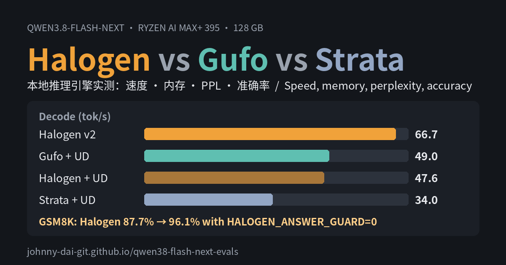

<div align="center">

# Strix Halo LLM Bench

**Inference engines measured head-to-head on AMD Ryzen AI Max+ 395 (Strix Halo, 128 GB): speed, memory, perplexity and accuracy, with every raw reply published.**

[](https://johnny-dai-git.github.io/strix-halo-llm-bench/)
[](https://johnny-dai-git.github.io/strix-halo-llm-bench/memory.html)
[](runner/)
[](LICENSE)

English · [中文](README.zh-CN.md)

[](https://johnny-dai-git.github.io/strix-halo-llm-bench/)

</div>

## Contents

- [Key findings](#key-findings)
- [Results](#results)
- [The setups](#the-setups)
- [Method](#method)
- [Reproduce](#reproduce)
- [Repository layout](#repository-layout)
- [Limitations](#limitations)
- [Citation](#citation)

## Key findings

Model: **Qwen3.8-Flash-Next**. Engines: **Halogen 0.18.18**, **Gufo 0.27.0**, **Strata 0.2.7**. One machine, identical requests, one engine at a time.

1. **Halogen on its native v2 weights is the fastest and leanest setup.** 66.7 tok/s decode, about 1,700–1,800 tok/s prompt processing, and 40.1 GiB of memory left for other software.
2. **On the same Unsloth UD-Q4_K_XL weights, Gufo and Halogen are close; Strata trails.** Gufo 49.0 and Halogen 47.6 tok/s decode against Strata's 34.0, and 3–4× faster prompt processing than Strata, which nearly fills memory and stalled once.
3. **Accuracy is a tie.** Halogen v2 and Gufo + UD-Q4_K_XL match on HumanEval, IFEval, GSM8K and MMLU-Pro, within 95% intervals.
4. **One engine default costs 8 points on GSM8K.** Halogen's answer guard won't let a reply end on a `#### <number>` line. Turning it off (`HALOGEN_ANSWER_GUARD=0`) takes GSM8K from 87.7% to 96.1%. Reported upstream as [peonist-ai/halogen-flash-server#259](https://github.com/peonist-ai/halogen-flash-server/issues/259).
5. **The UD-Q4_K_XL weights have about 2% lower perplexity than Halogen's v2 weights** on WikiText-2, a small but statistically clear gap that doesn't show up in the four accuracy benchmarks.
6. **Three Halogen memory settings save 14.8 GiB at almost no speed cost** (89.0 → 74.2 GiB, decode −0.5%). See the [memory compression report](https://johnny-dai-git.github.io/strix-halo-llm-bench/memory.html).

## Results

The [full report](https://johnny-dai-git.github.io/strix-halo-llm-bench/) has interactive charts, per-prompt data, the engines' own benchmark tools, power and thermals.

### Speed

Thinking off, greedy decoding, MTP drafting on. Every prompt is new, so no prompt cache helps. Best per row in bold.

| tok/s | Halogen v2 | Halogen + UD | Gufo + UD | Strata + UD |
|---|---:|---:|---:|---:|
| Decode, 3 short prompts (avg) | **66.7** | 47.6 | 49.0 | 34.0 |
| Prompt, 8K | **1,742** | 1,416 | 1,478 | 446 |
| Prompt, 32K | **1,788** | 1,453 | 1,526 | 479 |
| Prompt, 131K | **1,688** | 1,401 | 1,433 | 373 |
| 30,023-token prompt, seconds | **16.5** | 20.1 | 20.1 | 62.7 |

**Update, 2026-11-13: Gufo 0.34.** The table above is Gufo 0.27.0 on the balanced power profile. Re-measured on 0.34.0 with the performance profile, Gufo's own `gufo bench` gives 62.3 tok/s decode with MTP (was 48.4) and 1,729 tok/s for pp2048 (was 1,515; published 1,801). About +9% of the prompt-speed gain comes from the power profile and +4–5% from the new version; the MTP decode gain (+28%) is the new version. Halogen and Strata were not re-run, so the table above stays as measured. Details and raw output: [runner/results/speed](runner/results/speed/).

### Memory and load

| | Halogen v2 | Halogen + UD | Gufo + UD | Strata + UD |
|---|---:|---:|---:|---:|
| Engine total (GiB) | **74.2** | 95.0 | 92.1 | ~112 |
| Left for other software (GiB) | **40.1** | 19.6 | 25.0 → 19.3 | ~6 → 1.1 |
| Swap pushed out (GiB) | 0 | 0 | 0 | 4.5 |
| Load to ready (s) | 29 | 42 | **23** | 62 |

Power under load was about 84 W for every setup, so energy per token tracks speed.

### Accuracy

Thinking off, temperature 0. ± is the 95% binomial interval.

| | HumanEval (164) | IFEval strict (541) | GSM8K (1,319) | MMLU-Pro (1,000) |
|---|---:|---:|---:|---:|
| Halogen v2 | 96.3 ± 2.9 | 82.8 ± 3.2 | 87.7 ± 1.8 | 77.4 ± 2.6 |
| Halogen v2, answer guard off | — | — | **96.1 ± 1.1** | — |
| Halogen + UD | 97.0 ± 2.6 | 84.8 ± 3.0 | 84.1 ± 2.0 | 76.1 ± 2.6 |
| Gufo + UD | 97.0 ± 2.6 | 83.2 ± 3.2 | 96.0 ± 1.1 | 77.2 ± 2.6 |
| Strata + UD | 97.6 ± 2.4 | 93.2 ± 5.8 (73 only) | — | — |

Strata was stopped after HumanEval and 73 IFEval prompts, so its IFEval score isn't comparable with the others.

### Perplexity (WikiText-2 test, 297,192 tokens)

| Context | v2 weights | UD-Q4_K_XL | Paired difference (nats/token) | 95% CI |
|---|---:|---:|---:|---:|
| 4,096-token windows | 4.2717 | **4.1828** | −0.0210 | −0.0229 … −0.0192 |
| Whole set as one sequence | 3.7791 | **3.7048** | −0.0199 | −0.0215 … −0.0183 |

## The setups

| | Halogen v2 | Halogen + UD | Gufo + UD | Strata + UD |
|---|---|---|---|---|
| Engine | Halogen 0.18.18 | Halogen 0.18.18 | Gufo 0.27.0 | Strata 0.2.7 (engine 0.1.52, hip-halo) |
| Weights | Halogen v2, ~4.16 bpw | Unsloth UD-Q4_K_XL GGUF | Unsloth UD-Q4_K_XL GGUF | Unsloth UD-Q4_K_XL GGUF |
| MTP draft head | built in | Halogen's head file | shared-Q8_0 GGUF | Strata's converted head |
| Context / KV cache | 262,144 / int8 | 262,144 / int8 | 262,144 / default | 262,144 / int8 |

UD-Q4_K_XL is `unsloth/Qwen3.8-Flash-Next-GGUF` at revision `38bb39e` (111.3 GB, sha256-checked). Exact launch commands are in [`runner/setups.experiment.conf`](runner/setups.experiment.conf).

**Hardware:** GMKtec EVO-X3, AMD Ryzen AI Max+ 395 (gfx1151), 128 GB unified memory, BIOS VRAM carve-out 1 GB, GTT limit 112 GiB. Ubuntu 26.04.1, kernel 7.0.0, rootless Podman 5.7.0, balanced power profile.

## Method

- **Speed and memory:** `llm-probe.sh` sends identical requests to every setup (3 short prompts with 256 tokens out; 8K, 32K and 131K prompts with 128 tokens out; one 30,023-token prompt) while sampling GTT, available memory, package power and GPU temperature every 0.5 s. Strata's own `strata bench run` (standard-v1) was replayed unchanged to the other engines.
- **Perplexity:** Halogen's `ppl` tool on both weight sets (same corpus, tokenizer and arithmetic), with a per-token paired test.
- **Accuracy:** the harness in [`runner/`](runner/), over the OpenAI-compatible `/v1/chat/completions` endpoint, one request at a time. HumanEval pass@1 runs the code against the official tests; IFEval uses lm_eval's official checker; GSM8K takes the number after the last `####`; MMLU-Pro is a 1,000-question sample stratified by subject (seed 1234).
- Engines ran one at a time, with GPU memory confirmed released (≤ 0.3 GiB) before each switch.

## Reproduce

Every reply from the accuracy runs is in [`runner/results/`](runner/results/). Re-score them without an inference server:

```bash
cd runner
python3 -m venv .venv && . .venv/bin/activate
pip install -r requirements.txt && pip install --no-deps lm_eval==0.4.13
python3 fetch_data.py      # eval sets at pinned Hugging Face revisions, sha256-checked
python3 rescore.py         # re-scores every saved reply
```

Or run the evals against your own server:

```bash
python3 run_evals.py --name my-setup --base-url http://127.0.0.1:8080/v1
```

See [`runner/README.md`](runner/README.md) for details.

## Repository layout

| Path | What it is |
|---|---|
| [`index.html`](index.html) | The full report (GitHub Pages), English / 中文 |
| [`memory.html`](memory.html) | Halogen memory compression report |
| [`runner/`](runner/) | Accuracy harness, data fetcher, re-scorer, every saved reply |
| [`data/`](data/) | Summary JSON and the memory report's raw CSVs |
| [`assets/`](assets/) | Preview images |

## Limitations

- One machine and one model. Thinking off throughout; results with thinking on will differ.
- Strata's accuracy run is partial (HumanEval and 73 IFEval prompts).
- The accuracy runs used slightly different launch settings from the speed runs (see the report's Method section); their speeds aren't comparable to the speed tables.
- Halogen + UD-Q4_K_XL on GSM8K (84.1%) likely has the same answer-guard problem but wasn't re-run with the guard off.
- About 14–15% of MMLU-Pro replies hit the 2,048-token limit without an answer on every engine, which lowers all MMLU-Pro scores equally.

## Citation

```bibtex
@misc{strixhalollmbench2026,
  title  = {Strix Halo LLM Bench: Halogen, Gufo and Strata on AMD Ryzen AI Max+ 395},
  author = {Johnny-dai-git},
  year   = {2026},
  url    = {https://github.com/Johnny-dai-git/strix-halo-llm-bench}
}
```

## License

Code and data in this repository are released under the [MIT License](LICENSE). The eval sets belong to their authors: HumanEval (OpenAI, MIT), IFEval (Google, Apache-2.0), GSM8K (OpenAI, MIT), MMLU-Pro (TIGER-Lab, MIT).
