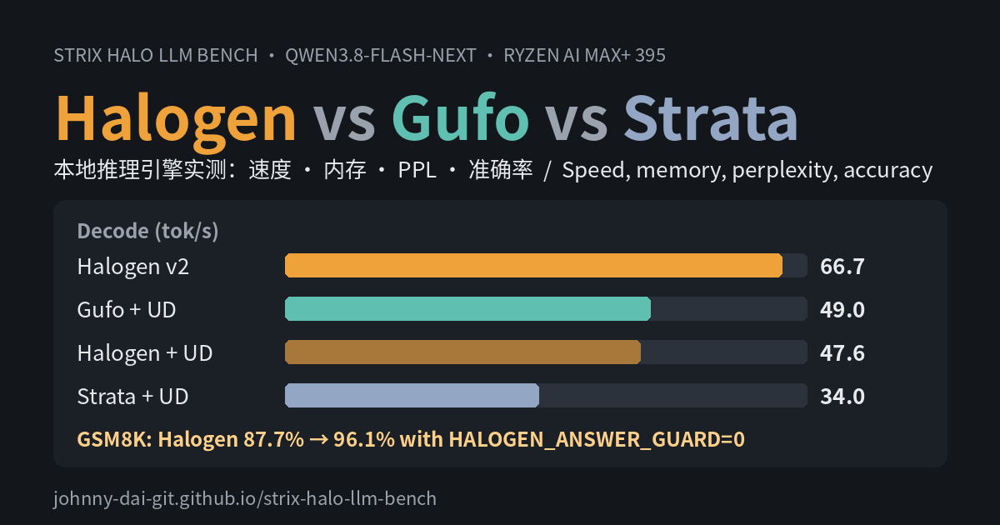

<div align="center">

# Strix Halo LLM Bench

**在 AMD Ryzen AI Max+ 395（Strix Halo，128 GB）上正面对比本地推理引擎：速度、内存、困惑度和准确率，每一条原始回答都公开。**

[](https://johnny-dai-git.github.io/strix-halo-llm-bench/)
[](https://johnny-dai-git.github.io/strix-halo-llm-bench/memory.html)
[](runner/)
[](LICENSE)

[English](README.md) · 中文

[](https://johnny-dai-git.github.io/strix-halo-llm-bench/)

</div>

## 目录

- [主要结论](#主要结论)
- [结果](#结果)
- [测试配置](#测试配置)
- [测试方法](#测试方法)
- [复现](#复现)
- [仓库结构](#仓库结构)
- [局限](#局限)
- [引用](#引用)

## 主要结论

模型：**Qwen3.8-Flash-Next**。引擎：**Halogen 0.18.18**、**Gufo 0.27.0**、**Strata 0.2.7**。同一台机器、完全相同的请求，引擎轮流单独运行。

1. **Halogen 用自家 v2 权重最快、最省内存。** 生成 66.7 tok/s，读提示约 1,700–1,800 tok/s，还留出 40.1 GiB 给其他软件。
2. **同一份 Unsloth UD-Q4_K_XL 权重上，Gufo 和 Halogen 接近，Strata 落后。** 生成速度 Gufo 49.0、Halogen 47.6、Strata 34.0 tok/s；读提示比 Strata 快 3–4 倍。Strata 几乎占满内存，还卡死过一次。
3. **准确率打平。** Halogen v2 和 Gufo + UD-Q4_K_XL 在 HumanEval、IFEval、GSM8K、MMLU-Pro 上的差距都在 95% 置信区间内。
4. **一个引擎默认设置让 GSM8K 少了 8 分。** Halogen 的 answer guard 不让回答停在 `#### <数字>` 这一行。关掉它（`HALOGEN_ANSWER_GUARD=0`）后，GSM8K 从 87.7% 升到 96.1%。已报告给上游：[peonist-ai/halogen-flash-server#259](https://github.com/peonist-ai/halogen-flash-server/issues/259)。
5. **UD-Q4_K_XL 权重在 WikiText-2 上的困惑度比 Halogen v2 权重低约 2%。** 差距小但统计上很明确，在四项准确率测试里没有体现出来。
6. **Halogen 的三个内存参数能省 14.8 GiB，速度几乎不变**（89.0 → 74.2 GiB，生成慢 0.5%）。详见[内存压缩报告](https://johnny-dai-git.github.io/strix-halo-llm-bench/memory.html)。

## 结果

[完整报告](https://johnny-dai-git.github.io/strix-halo-llm-bench/)里有交互图表、逐提示数据、各引擎自带测试工具的结果，以及功耗和温度。

### 速度

关闭思考，贪心解码，开启 MTP 草稿。每个提示都是新的，提示缓存帮不上忙。每行最好的加粗。

| tok/s | Halogen v2 | Halogen + UD | Gufo + UD | Strata + UD |
|---|---:|---:|---:|---:|
| 生成，3 个短提示平均 | **66.7** | 47.6 | 49.0 | 34.0 |
| 读提示 8K | **1,742** | 1,416 | 1,478 | 446 |
| 读提示 32K | **1,788** | 1,453 | 1,526 | 479 |
| 读提示 131K | **1,688** | 1,401 | 1,433 | 373 |
| 读 30,023 token 提示（秒） | **16.5** | 20.1 | 20.1 | 62.7 |

### 内存与加载

| | Halogen v2 | Halogen + UD | Gufo + UD | Strata + UD |
|---|---:|---:|---:|---:|
| 引擎合计（GiB） | **74.2** | 95.0 | 92.1 | 约 112 |
| 留给其他软件（GiB） | **40.1** | 19.6 | 25.0 → 19.3 | 约 6 → 1.1 |
| 挤进交换空间（GiB） | 0 | 0 | 0 | 4.5 |
| 加载到可用（秒） | 29 | 42 | **23** | 62 |

四套配置负载时功耗都在 84 W 左右，所以每个 token 的耗电和速度成反比。

### 准确率

关闭思考，温度 0。± 为 95% 二项置信区间。

| | HumanEval（164） | IFEval 严格（541） | GSM8K（1,319） | MMLU-Pro（1,000） |
|---|---:|---:|---:|---:|
| Halogen v2 | 96.3 ± 2.9 | 82.8 ± 3.2 | 87.7 ± 1.8 | 77.4 ± 2.6 |
| Halogen v2，关闭 answer guard | — | — | **96.1 ± 1.1** | — |
| Halogen + UD | 97.0 ± 2.6 | 84.8 ± 3.0 | 84.1 ± 2.0 | 76.1 ± 2.6 |
| Gufo + UD | 97.0 ± 2.6 | 83.2 ± 3.2 | 96.0 ± 1.1 | 77.2 ± 2.6 |
| Strata + UD | 97.6 ± 2.4 | 93.2 ± 5.8（仅 73 题） | — | — |

Strata 跑完 HumanEval 和 73 道 IFEval 后就停了，它的 IFEval 分数不能和其他配置直接比较。

### 困惑度（WikiText-2 测试集，297,192 token）

| 上下文 | v2 权重 | UD-Q4_K_XL | 逐 token 配对差（nats/token） | 95% 置信区间 |
|---|---:|---:|---:|---:|
| 每段 4,096 token | 4.2717 | **4.1828** | −0.0210 | −0.0229 … −0.0192 |
| 整个测试集一条长序列 | 3.7791 | **3.7048** | −0.0199 | −0.0215 … −0.0183 |

## 测试配置

| | Halogen v2 | Halogen + UD | Gufo + UD | Strata + UD |
|---|---|---|---|---|
| 引擎 | Halogen 0.18.18 | Halogen 0.18.18 | Gufo 0.27.0 | Strata 0.2.7（引擎 0.1.52，hip-halo） |
| 权重 | Halogen v2，约 4.16 bit | Unsloth UD-Q4_K_XL GGUF | Unsloth UD-Q4_K_XL GGUF | Unsloth UD-Q4_K_XL GGUF |
| MTP 草稿层 | 权重内置 | Halogen 自己的头文件 | shared-Q8_0 GGUF | Strata 转换的版本 |
| 上下文 / 对话缓存 | 262,144 / int8 | 262,144 / int8 | 262,144 / 默认 | 262,144 / int8 |

UD-Q4_K_XL 指 `unsloth/Qwen3.8-Flash-Next-GGUF` 的 revision `38bb39e`（111.3 GB，已校验 sha256）。完整启动命令见 [`runner/setups.experiment.conf`](runner/setups.experiment.conf)。

**硬件：** GMKtec EVO-X3，AMD Ryzen AI Max+ 395（gfx1151），128 GB 统一内存，BIOS 显存划分 1 GB，GTT 上限 112 GiB。Ubuntu 26.04.1，内核 7.0，rootless Podman 5.7.0，电源模式“平衡”。

## 测试方法

- **速度和内存：** `llm-probe.sh` 给每套配置发完全相同的请求（3 个短提示各生成 256 token；8K、32K、131K 提示各生成 128 token；一个 30,023 token 长提示），同时每 0.5 秒记录 GTT、可用内存、芯片功耗和 GPU 温度。Strata 自带的 `strata bench run`（standard-v1）原样重放给其他引擎。
- **困惑度：** 两套权重都用 Halogen 的 `ppl` 工具计算（同一语料、分词器和算法），并做逐 token 配对检验。
- **准确率：** 用 [`runner/`](runner/) 里的评测工具，通过 OpenAI 兼容的 `/v1/chat/completions` 接口，一次一个请求。HumanEval pass@1 用官方测试运行代码；IFEval 用 lm_eval 的官方评分代码；GSM8K 取最后一个 `####` 后的数字；MMLU-Pro 按学科分层抽 1,000 题（种子 1234）。
- 引擎轮流单独运行，切换前确认显卡内存已释放（≤ 0.3 GiB）。

## 复现

准确率评测的每一条回答都在 [`runner/results/`](runner/results/)。不需要推理服务器也能重新打分：

```bash
cd runner
python3 -m venv .venv && . .venv/bin/activate
pip install -r requirements.txt && pip install --no-deps lm_eval==0.4.13
python3 fetch_data.py      # 按固定 revision 从 Hugging Face 下载评测集，并校验 sha256
python3 rescore.py         # 给所有保存的回答重新打分
```

也可以对你自己的服务器跑评测：

```bash
python3 run_evals.py --name my-setup --base-url http://127.0.0.1:8080/v1
```

详见 [`runner/README.md`](runner/README.md)。

## 仓库结构

| 路径 | 内容 |
|---|---|
| [`index.html`](index.html) | 完整报告（GitHub Pages），English / 中文 |
| [`memory.html`](memory.html) | Halogen 内存压缩报告 |
| [`runner/`](runner/) | 准确率评测工具、数据下载、重新打分脚本、每一条保存的回答 |
| [`data/`](data/) | 汇总 JSON 和内存报告的原始 CSV |
| [`assets/`](assets/) | 预览图 |

## 局限

- 只测了一台机器、一个模型，全程关闭思考；开启思考后结果会不同。
- Strata 的准确率只跑了一部分（HumanEval 和 73 道 IFEval）。
- 准确率评测的启动设置和速度测试略有不同（见报告的“测试方法”），那组运行的速度不能和速度表直接比较。
- Halogen + UD-Q4_K_XL 的 GSM8K（84.1%）很可能也受 answer guard 影响，但没有关掉 guard 重跑。
- 所有引擎在 MMLU-Pro 上都有约 14–15% 的回答写满 2,048 token 上限还没给出答案，各引擎的分数都被同样压低。

## 引用

```bibtex
@misc{strixhalollmbench2026,
  title  = {Strix Halo LLM Bench: Halogen, Gufo and Strata on AMD Ryzen AI Max+ 395},
  author = {Johnny-dai-git},
  year   = {2026},
  url    = {https://github.com/Johnny-dai-git/strix-halo-llm-bench}
}
```

## 许可

本仓库的代码和数据以 [MIT 许可证](LICENSE)发布。评测集版权归原作者：HumanEval（OpenAI，MIT）、IFEval（Google，Apache-2.0）、GSM8K（OpenAI，MIT）、MMLU-Pro（TIGER-Lab，MIT）。
